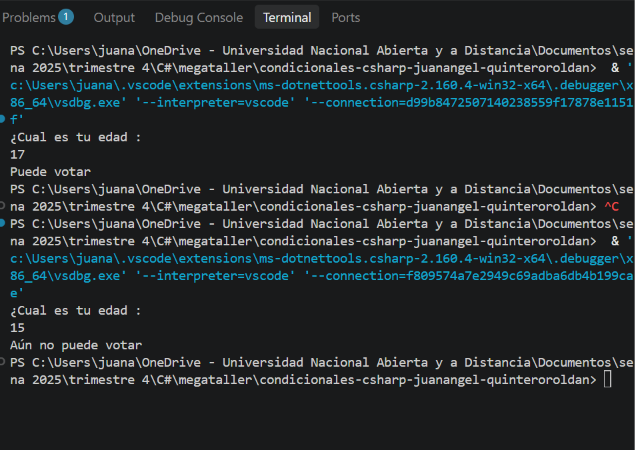

# Problema 01. Registro electoral

**Estructura elegida:** operador condicional ternario.

**Justificación:** la edad produce uno de dos resultados posibles según se alcance el mínimo de 16 años.

**Ejecución:** ingresa una edad para saber si la persona puede votar.

**Ejemplos:** `17` → `Puede votar`; `15` → `Aún no puede votar`.

**Evidencia:**

